# Hi, I'm Lucas 👋

📍 **Cologne** | Software Engineer | Climate Tech | Product-minded

Working at [ENTENDIX GmbH](https://www.entendix.com/)

## Projects

- 🖼️ **[automatic-image-culling](https://github.com/shurkanTwo/automatic-image-culling)** - Developing the original image-culling tool into a local desktop app for reviewing photo collections: automatic first-pass suggestions, side-by-side comparison, ratings, collections, and a Lightroom Classic handoff. Built with Rust/Tauri, React/TypeScript, and Python.
- 🎾 **[TennisOnlineBuchen](https://tennisonlinebuchen.de/)** - Tennis booking platform for clubs, with full-stack and product ownership from user needs to hosting. Modernizing the PHP/JavaScript application through a Laravel, Vue, and Inertia rewrite, including feature parity, data migration, automated testing, and deployment.
- 📷 **[Lightcraft](https://github.com/storytold/lightcraft)** - Contributing to an open-source photo editor written in Rust.

### More projects and contributions

- 🧹 **[chromium-tab-sorter-cleaner](https://github.com/shurkanTwo/chromium-tab-sorter-cleaner)** - Chromium extension for sorting tabs, removing duplicates, and grouping by content or domain.
- 🔥 **[heating-consumption-visualizer](https://github.com/shurkanTwo/heating-consumption-visualizer)** - Heating data exploration with room-level plots and comparison charts.
- 🌌 **[NINASonyCameraPlugin](https://github.com/shurkanTwo/NINASonyCameraPlugin)** - Bugfixes and updates for Sony camera control in N.I.N.A astrophotography workflows.

## Philosophy

> I like to be creative and think outside the box to find new and unexpected solutions.

## AI-Assisted Development

- 🤖 **Everyday engineering:** I use Claude Code and Codex for professional and personal projects, from exploration and implementation to refactoring and review. At work, I built a production service through a workflow spanning many agent sessions.
- 🧭 **Continuity across sessions:** Repository instructions, backlog and state tracking, and architecture decision records keep work understandable and make it easier to resume.
- 🔧 **Agent workflows:** T3 Code, subagents, git worktrees for parallel work, reusable skills, and MCP integrations such as Context7 and Serena. I tune context and tool output to keep sessions focused and efficient.
- 🧠 **Tool experience:** Claude, ChatGPT, Codex, Claude Code, and Cursor across terminal, editor, and web workflows. I choose tools for the task and keep experimenting as they evolve.
- 🔍 **Traceability:** Entire.io checkpoints and session transcripts connect agent-generated changes with the sessions that produced them.
- ✅ **Quality:** Automated tests, browser checks, code and repository reviews, and documentation upkeep are part of the development workflow.

## Connect

- 💼 [LinkedIn](https://www.linkedin.com/in/lucas-lepski-4402b3142/)
- 🧑‍💻 [GitHub](https://github.com/shurkanTwo)
- 🌐 [Website](https://www.lepski.info/) (photography only, not related to software dev)

## Statistics

  <em>The counts include private contributions. The language card covers only my own repositories, so my professional Java, Kotlin, and TypeScript work doesn't appear there.</em>

  <small style="color:#888;"><em>Updated daily by a GitHub Action using <a href="https://github.com/stats-organization/github-stats-extended">GitHub Stats Extended</a>, the maintained successor of <a href="https://github.com/anuraghazra/github-readme-stats">anuraghazra/github-readme-stats</a>.</em></small>

